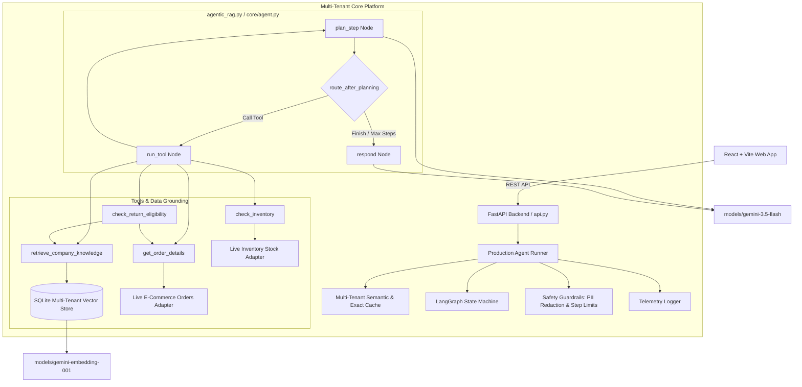

# Multi-Company AI Customer Support & RAG Platform

An enterprise-ready, multi-tenant AI customer support platform built on **Python**, **LangChain**, **LangGraph**, and **Google Gemini**, with a modern **React + Vite** frontend.

The platform eliminates all local dummy data in favor of real company documents, live operational integration adapters, strict server-side tenant isolation, multi-tenant semantic caching, real-time observability, and safety guardrails.

---

## 1. Architecture Overview



### Key Pillars
1. **Zero Local Demo Data**:
   - Removed obsolete `ORDERS_DB`, hardcoded `POLICIES`, and mock return fees.
   - When external systems (orders, inventory) are not configured, the agent explicitly and politely informs the user without guessing or fabricating data.
2. **Real Multi-Tenant Isolation**:
   - Each company maintains its own isolated documents, chunks, and cached answers.
   - Every database query and vector similarity search strictly enforces `company_id`.
3. **Multi-Tenant Semantic & Exact Caching**:
   - Caches query responses with exact SHA-256 and semantic vector similarity (> 0.95 cosine similarity).
   - Scoped by `company_id` and optional `customer_id`.
   - Automatically invalidated whenever company documents are uploaded or deleted.
4. **Real Observability & Metrics**:
   - Real query telemetry logged to SQLite: execution latencies, step counts, tools invoked, and cache hits.
   - Zero invented numbers in dashboard analytics.
5. **Safety Guardrails**:
   - Execution step limits prevent infinite ReAct loops.
   - PII redaction masks sensitive data (`[SSN]`, `[CARD]`, `[EMAIL]`, `[PHONE]`).
   - Grounded citation verification against verified retrieved documents.
   - Prompt-injection defense treats retrieved document chunks as untrusted data.

---

## 2. Directory Structure

```
agentic_customer_support/
├── core/                         # Core multi-tenant platform modules
│   ├── agent.py                  # LangGraph multi-tenant agent workflow
│   ├── cache.py                  # Multi-tenant exact + semantic cache
│   ├── guardrails.py             # Safety limits, PII masking, citation validation
│   ├── integrations.py           # Live E-Commerce & Inventory adapters (NO fake data)
│   ├── knowledge_base.py         # Multi-tenant document ingestion & vector store
│   └── metrics.py                # Telemetry & query logging in SQLite
├── data/                         # Persistent storage
│   └── support_platform.db       # SQLite DB (companies, documents, chunks, metrics)
├── frontend/                     # React + Vite commercial web app
│   ├── src/
│   │   ├── App.jsx               # Dashboard, Chat, KB, Integrations, Analytics, Settings
│   │   ├── index.css             # Vanilla CSS design system (dark mode, Indigo/Violet)
│   │   └── main.jsx
│   ├── package.json
│   └── index.html
├── tests/
│   └── test_platform.py          # Universal unittest suite (11 comprehensive tests)
├── .env.example                  # Environment configuration template
├── agentic_rag.py                # Backward-compatible agent script & API wrapper
├── api.py                        # FastAPI backend & static frontend server
├── requirements.txt              # Python dependencies
└── README.md
```

---

## 3. Setup and Installation

### Prerequisites
- Python 3.10+
- Node.js 18+ and npm
- A Google Gemini API key ([Google AI Studio](https://aistudio.google.com/))

### 1. Install Backend Dependencies
```bash
pip install -r requirements.txt
```

### 2. Configure Environment Variables
Copy `.env.example` to `.env` and set your `GEMINI_API_KEY`:
```bash
cp .env.example .env
```
Contents of `.env`:
```env
GEMINI_API_KEY=your_gemini_api_key_here
GEMINI_MODEL=gemini-3.5-flash
GEMINI_EMBEDDING_MODEL=models/gemini-embedding-001
PORT=8000
HOST=0.0.0.0
```

### 3. Build Frontend Assets
```bash
cd frontend
npm install
npm run build
cd ..
```

---

## 4. Running the Platform

### Start the Unified Server (Backend + Frontend)
```bash
uvicorn api:app --host 0.0.0.0 --port 8000 --reload
```
Once started, open **`http://localhost:8000`** in your browser.

- **FastAPI Interactive Docs**: `http://localhost:8000/docs`
- **Health Check Endpoint**: `http://localhost:8000/api/health`

### Frontend Development Mode (Optional)
If modifying the React frontend with Vite HMR:
```bash
cd frontend
npm run dev
```

---

## 5. Supported Document Ingestion

Supported file formats:
- **PDF** (`.pdf`): Extracted page-by-page via `pypdf`, preserving `page_number` in chunk metadata.
- **DOCX** (`.docx`): Extracted paragraphs and tables via `python-docx`.
- **TXT / Markdown** (`.txt`, `.md`): Extracted sections with character overlap.
- **CSV** (`.csv`): Extracted rows with header mapping, preserving row numbers.

### Document Upload Workflow
1. Navigate to **Knowledge Base** in the dashboard.
2. Drag and drop or browse to select your document.
3. The server extracts text, generates embeddings with `models/gemini-embedding-001`, and stores chunks in `support_platform.db`.
4. The company's semantic cache is automatically invalidated.
5. All future AI Support Chat answers for that company immediately ground themselves in the uploaded document.

---

## 6. Live Business Integrations

Under **Settings & Integrations**, you can configure real external endpoints:

### E-Commerce Orders API
- Endpoint format:
  - `GET /orders/{order_id}`: Must return order object (`order_id`, `status`, `delivery_date`, `total`, `items`).
  - `GET /health`: Returns HTTP 200.
- Optional Bearer token authentication.

### Inventory API
- Endpoint format:
  - `GET /inventory/{product_id}`: Must return inventory object (`product_id`, `stock_quantity`, `last_updated`).
  - `GET /health`: Returns HTTP 200.

### Behavior When Unconfigured
- If an integration is not connected, the agent **never fabricates data**.
- Queries like *"Where is my order #12345?"* truthfully inform the customer:
  > *"Order integration is not configured. Please configure an authorized database or e-commerce API in Settings."*

---

## 7. Testing and Verification

Run the comprehensive test suite verifying tenant isolation, RAG, caching, guardrails, and API endpoints:
```bash
python -m unittest tests/test_platform.py -v
```

All 11 tests execute in ~14 seconds:
- `test_01_txt_and_csv_parsing`: Verifies multi-format parsing and location tags.
- `test_02_chunking_metadata`: Verifies chunk splitting and metadata attribution.
- `test_03_tenant_isolation_and_deletion`: Verifies Company A cannot access Company B's knowledge, and document deletion cleans vector chunks.
- `test_04_customer_order_authorization`: Verifies customer authorization checks.
- `test_05_unconfigured_integrations_fail_safely`: Verifies zero local fake data fallbacks.
- `test_06_return_eligibility_unconfigured`: Verifies return evaluation when orders are unverified.
- `test_07_cache_tenant_isolation`: Verifies semantic cache entries cannot leak across companies.
- `test_08_guardrails_pii_masking`: Verifies SSN, Credit Card, Email redaction.
- `test_09_guardrails_step_limit`: Verifies infinite loop prevention.
- `test_10_agent_unconfigured_order_handling`: Verifies end-to-end agent grounding.
- `test_11_fastapi_endpoints`: Verifies all REST endpoints and static UI serving.

---

## 8. Known Limitations & Production Readiness

1. **OAuth2 / SSO**: Tenant identification currently operates via API parameters and session context; integrating JWT-based bearer authentication is recommended before public deployment.
2. **Third-Party Connectors**: Native one-click OAuth integrations for Shopify, WooCommerce, and Salesforce can be added as dedicated adapters in `core/integrations.py`.
3. **Distributed Vector Index**: For deployments with millions of chunks per company, the SQLite vector store can be swapped with PostgreSQL + `pgvector` or Qdrant by updating `core/knowledge_base.py`.
